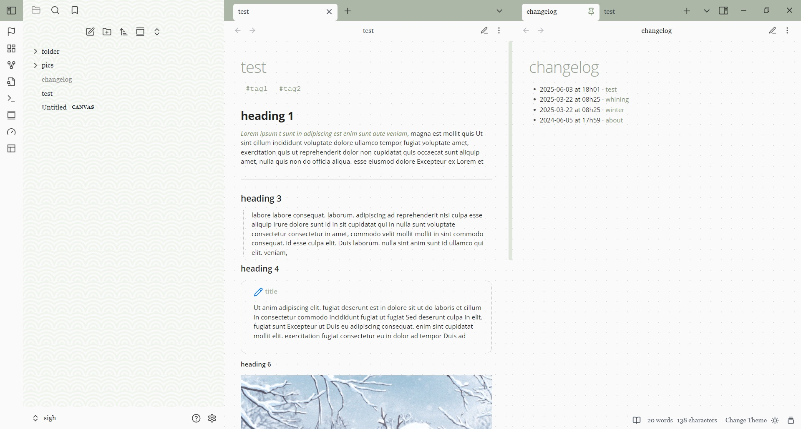
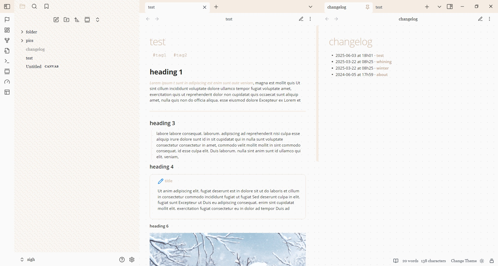
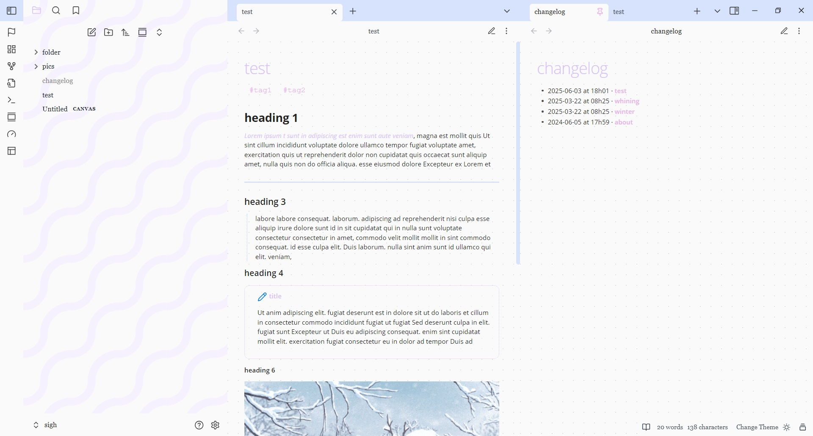
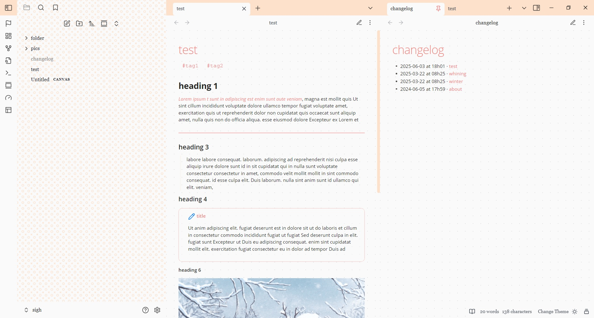
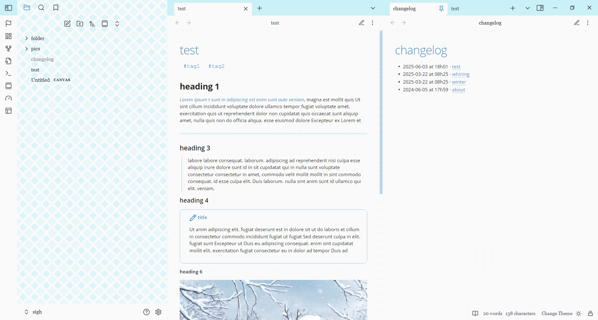
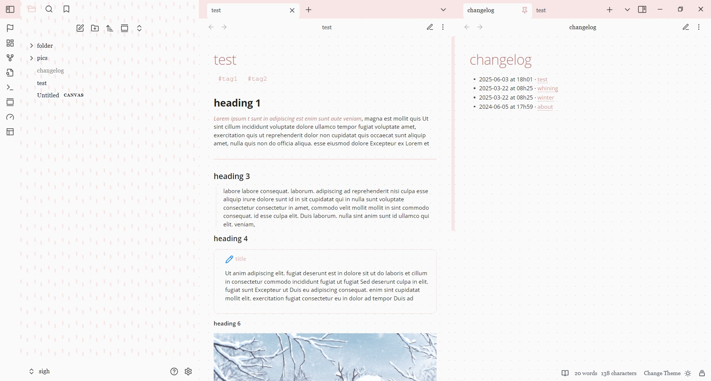

# Dashboard

A pastel theme with many colors and patterns, with the feel of a bullet journal.

Light mode only.

Color schemes to choose from with the style settings plugin: Matcha, Vanilla, Dreamscape, Peach, Pool, Strawberry

 
 
 

## Installation

1. Open Obsidian and go to **Settings > Appearance**.
2. Next to **Themes**, select **Manage**.
3. Search for "dashboard", then select **Install and use**.

To install by hand, download `manifest.json` and `theme.css` from the [latest release](https://github.com/incantatem2/Obsidian-dashboard/releases/latest). Put both files in a folder named `dashboard` inside `.obsidian/themes/` in your vault. Then choose the theme under **Settings > Appearance > Themes**.
